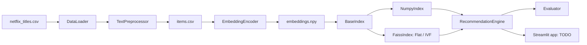

# Semantic Recommendation Engine

Semantic Recommendation Engine is an in-progress local semantic search project over Netflix Movies and TV Shows. It is designed to represent titles and descriptions with SentenceTransformers embeddings and retrieve titles by meaning using vector similarity, without sending queries to an external inference API.

## Features

- Semantic search over Netflix titles by meaning.
- Normalized text embeddings with inner product used as cosine similarity.
- Exact NumPy baseline and exact FAISS Flat / approximate FAISS IVF vector search.
- One-shot and interactive command-line search with optional category filtering.
- Evaluation with Recall@K, HitRate@K, MRR, and query latency; measured results are saved under `results/`.
- Streamlit search demo: TODO.

## Architecture

- `src/data_loader.py` — `DataLoader`: reads CSV data, applies column mappings, and validates required columns.
- `src/preprocessor.py` — `TextPreprocessor`: cleans catalog text, builds embedding text, removes short rows and duplicates, and prepares item IDs.
- `src/encoder.py` — `EmbeddingEncoder`: creates normalized SentenceTransformers embeddings and saves or loads NumPy arrays.
- `src/index.py` — `BaseIndex`, `NumpyIndex`, `FaissIndex`: common vector-search interface, exact NumPy and FAISS Flat search, and approximate FAISS IVF search.
- `src/engine.py` — `RecommendationEngine`: combines the encoder, index, and item metadata.
- `src/factory.py` — `build_engine`: loads item and embedding data and constructs a selected vector index.
- `src/evaluator.py` — `Evaluator`: computes ranking metrics and average query latency.
- `scripts/search_cli.py` — one-shot and interactive semantic search from the terminal.
- `src/app.py` — Streamlit interface for interactive recommendations (TODO: implementation).



## Installation

Use Python 3.10 or later.

```bash
python3 -m venv .venv
source .venv/bin/activate
pip install -r requirements.txt
```

## Data

Dataset: Netflix Movies and TV Shows from Kaggle. Dataset page URL and license: TODO. Download `netflix_titles.csv` from the verified Kaggle dataset page and place it at `data/raw/netflix_titles.csv`. Do not commit raw data.

See `docs/DATA_CARD.md` for dataset provenance, license, and known limitations (TODO: create this document).

## Usage

Run the implemented data and embedding steps in order. Fill `query` and `extra_relevant_ids` in `data/processed/eval_template.csv` manually, then run the validator/builder. Streamlit remains planned and is not implemented yet.

```bash
python -m scripts.process_data
python -m scripts.build_embeddings
python -m scripts.make_eval_template
# Manually annotate data/processed/eval_template.csv before continuing.
python -m scripts.build_eval_queries
python -m scripts.search_cli --query "a sad story about astronauts" --k 3
# Omit --query to start the interactive search prompt.
python -m scripts.run_evaluation --index numpy
python -m scripts.run_evaluation --index faiss-flat
python -m scripts.run_evaluation --index faiss-ivf
python -m scripts.error_analysis --index faiss-flat --worst 10
python -m scripts.evaluate_engine
```

## Evaluation

The table was measured on 8,804 catalog items and 50 manually reviewed queries using `sentence-transformers/all-MiniLM-L6-v2`. Query labels were prepared by inspecting item descriptions; no embedding search was used to select relevance labels. Latency measures `engine.recommend()` on CPU after one untimed warm-up query per index and can vary by machine and load. `python -m scripts.run_evaluation --index <numpy|faiss-flat|faiss-ivf>` reproduces one row and writes its metrics and per-query CSV under `results/`.

| Model / index | Queries | Recall@1 | HitRate@1 | Recall@3 | HitRate@3 | Recall@10 | HitRate@10 | MRR | Average latency (ms) |
| --- | ---: | ---: | ---: | ---: | ---: | ---: | ---: | ---: | ---: |
| all-MiniLM-L6-v2 / NumPy | 50 | 0.2100 | 0.2400 | 0.3200 | 0.3600 | 0.4217 | 0.4800 | 0.3116 | 234.1056 |
| all-MiniLM-L6-v2 / FAISS Flat | 50 | 0.2100 | 0.2400 | 0.3200 | 0.3600 | 0.4217 | 0.4800 | 0.3116 | 74.4520 |
| all-MiniLM-L6-v2 / FAISS IVF | 50 | 0.1900 | 0.2200 | 0.2700 | 0.3000 | 0.3817 | 0.4400 | 0.2821 | 76.6147 |

Per-query metrics and run metadata: [NumPy](results/per_query_numpy.csv), [FAISS Flat](results/per_query_faiss-flat.csv), [FAISS IVF](results/per_query_faiss-ivf.csv); aggregate metrics are in the matching `results/metrics_<index>.json` files.

## Project Structure

```text
semantic-recsys/
├── configs/
│   └── dataset.json
├── data/
│   ├── raw/
│   │   └── netflix_titles.csv  # download from Kaggle; raw data is not committed
│   └── processed/
│       ├── items.csv           # generated by process_data
│       ├── eval_template.csv   # generated by make_eval_template, then annotated
│       ├── eval_queries.csv    # validated by build_eval_queries
│       └── embeddings_<slug>.npy  # generated locally; binary files are ignored
├── docs/
│   ├── DATA_CARD.md            # TODO
│   └── figures/
├── notebooks/
│   └── 01_eda.py
├── results/
│   ├── eval_summary.json       # aggregate metrics and run configuration
│   └── retrieval_quality.csv   # per-query metrics and latency
├── scripts/
│   ├── process_data.py
│   ├── make_eval_template.py
│   ├── build_eval_queries.py
│   ├── build_embeddings.py
│   ├── evaluate_engine.py
│   └── search_cli.py
├── src/
│   ├── data_loader.py
│   ├── preprocessor.py
│   ├── encoder.py
│   ├── index.py
│   ├── engine.py
│   ├── factory.py
│   ├── evaluator.py
│   └── app.py                   # TODO
├── tests/
├── CONTRACTS.md
├── LICENSE                      # TODO: add the MIT license text
├── README.md
└── requirements.txt
```

## Team and Roles

| Role | Name | Responsibilities |
| --- | --- | --- |
| R1 — Team Lead / Software Architect | TODO | Architecture, integration, code review, and release. |
| R2 — Data Engineer | TODO | Data loading, preprocessing, EDA, and evaluation queries. |
| R3 — ML Engineer | TODO | Embeddings, vector indexes, and benchmarks. |
| R4 — Evaluation, Interface & Documentation Lead | TODO | Evaluation, demo interface, documentation, and report. |

## Acknowledgements

- SentenceTransformers: TODO: add the verified project URL and license details.
- FAISS: TODO: add the verified project URL and license details.
- Netflix Movies and TV Shows dataset: TODO: add the verified Kaggle URL and dataset license.

Netflix is not affiliated with, associated with, or sponsoring this project.

## License

This project is intended to be released under the MIT License. TODO: add the `LICENSE` file with the MIT license text.
