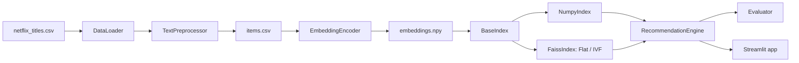
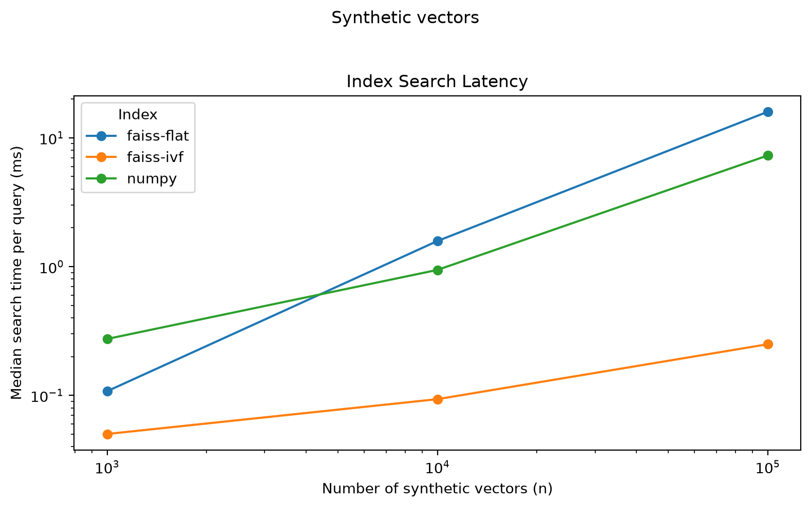
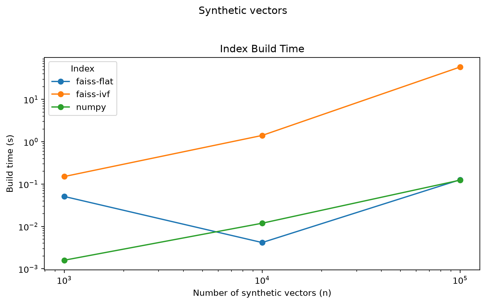
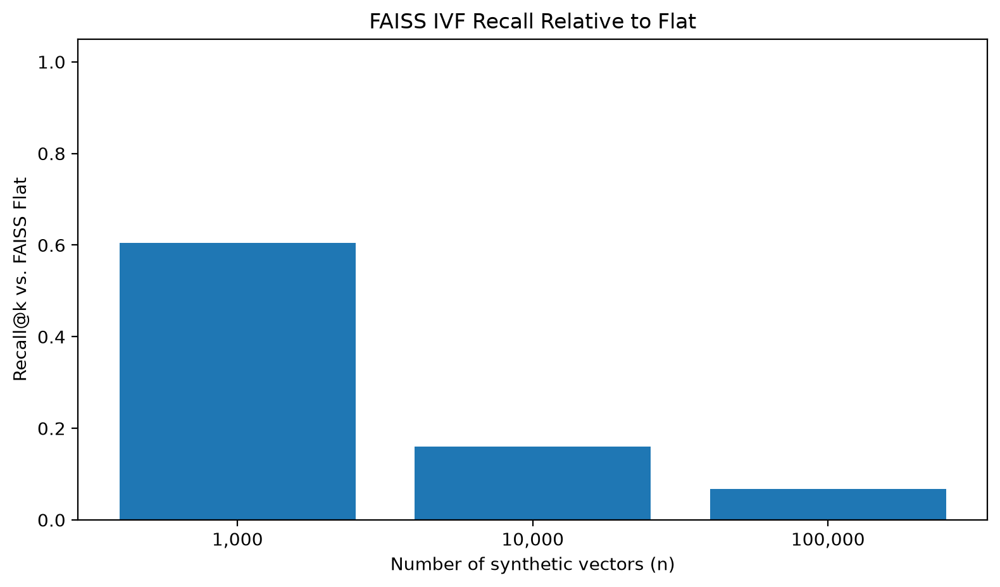
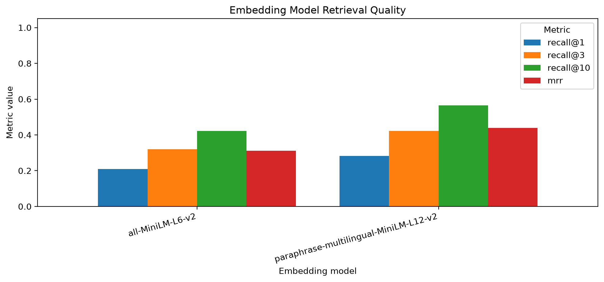
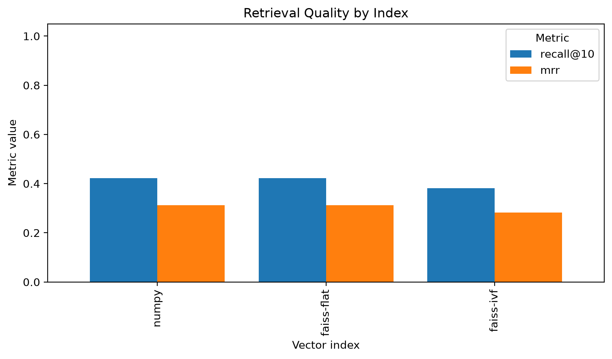
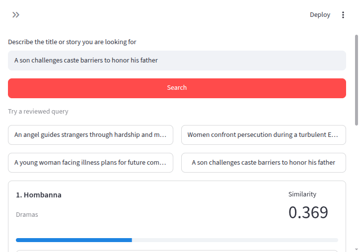
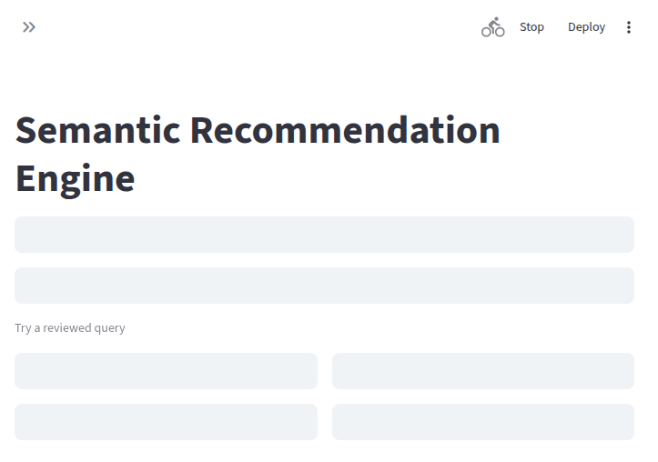
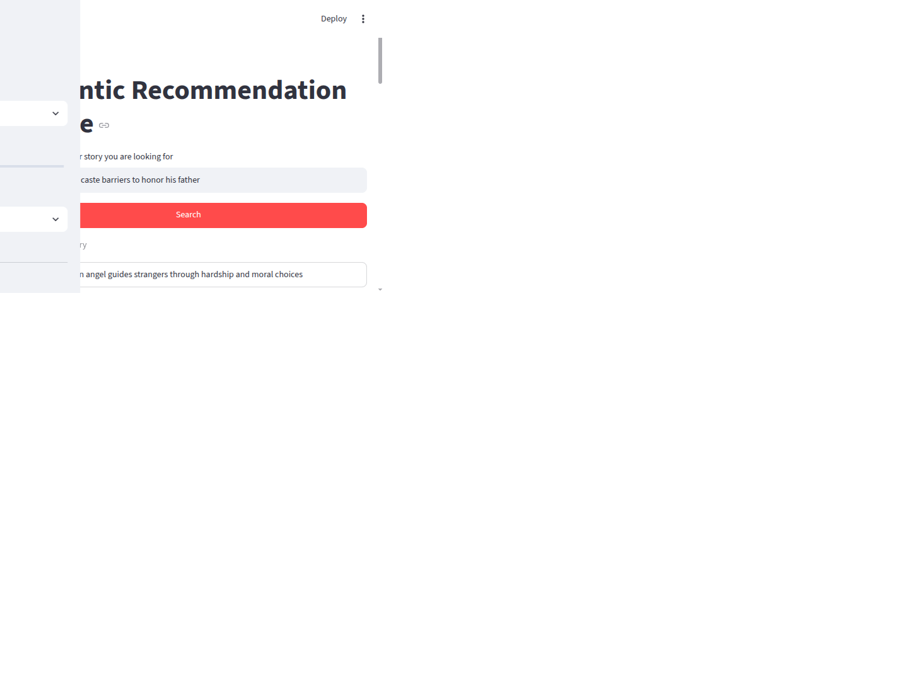

# Semantic Recommendation Engine

Semantic Recommendation Engine is a local semantic search project over Netflix Movies and TV Shows. It represents titles and descriptions with SentenceTransformers embeddings and retrieves titles by meaning using vector similarity, without sending queries to an external inference API.

## Features

- Semantic search over Netflix titles by meaning.
- Normalized text embeddings with inner product used as cosine similarity.
- Exact NumPy baseline and exact FAISS Flat / approximate FAISS IVF vector search.
- One-shot and interactive command-line search with optional category filtering.
- Evaluation with Recall@K, HitRate@K, MRR, and query latency; measured results are saved under `results/`.
- Streamlit search demo with index, category, and result-count controls.

## Architecture

- `src/data_loader.py` — `DataLoader`: reads CSV data, applies column mappings, and validates required columns.
- `src/preprocessor.py` — `TextPreprocessor`: cleans catalog text, builds embedding text, removes short rows and duplicates, and prepares item IDs.
- `src/encoder.py` — `EmbeddingEncoder`: creates normalized SentenceTransformers embeddings and saves or loads NumPy arrays.
- `src/index.py` — `BaseIndex`, `NumpyIndex`, `FaissIndex`: common vector-search interface, exact NumPy and FAISS Flat search, and approximate FAISS IVF search.
- `src/engine.py` — `RecommendationEngine`: combines the encoder, index, and item metadata.
- `src/factory.py` — `build_engine`: loads item and embedding data and constructs a selected vector index.
- `src/evaluator.py` — `Evaluator`: computes ranking metrics and average query latency.
- `scripts/search_cli.py` — one-shot and interactive semantic search from the terminal.
- `src/app.py` — Streamlit interface for interactive recommendations.



## Installation

Use Python 3.10 or later.

```bash
python3 -m venv .venv
source .venv/bin/activate
pip install -r requirements.txt
```

## Data

Dataset: [Netflix Movies and TV Shows](https://www.kaggle.com/datasets/shivamb/netflix-shows) from Kaggle. The Kaggle page lists CC0: Public Domain for the dataset contribution. Download `netflix_titles.csv` to `data/raw/netflix_titles.csv` and keep the raw archive out of version control. The repository stores only processed artifacts derived from that source. The dataset license does not imply Netflix endorsement or grant rights to Netflix marks or other third-party rights.

See [docs/DATA_CARD.md](docs/DATA_CARD.md) for dataset provenance, field usage, and known limitations.

## Usage

Run the data pipeline from the repository root. The evaluation template is manually annotated before building the final query set.

```bash
python -m scripts.process_data
python -m scripts.build_embeddings
python -m scripts.make_eval_template
# Manually annotate data/processed/eval_template.csv before continuing.
python -m scripts.build_eval_queries
python -m scripts.search_cli --query "a sad story about astronauts" --k 3
# Omit --query to start the interactive search prompt.
python -m scripts.run_evaluation --index numpy
python -m scripts.run_evaluation --index faiss-flat
python -m scripts.run_evaluation --index faiss-ivf
python -m scripts.error_analysis --index faiss-flat --worst 10
python -m scripts.benchmark_indexes
python -m scripts.compare_models
python -m scripts.make_plots
streamlit run src/app.py
```

## Reproduce results

After placing the raw Kaggle CSV at `data/raw/netflix_titles.csv`, run `python -m scripts.process_data` and `python -m scripts.build_embeddings`. Use the existing reviewed `data/processed/eval_template.csv` or create and review a new template with `python -m scripts.make_eval_template --n 60 --seed 42`; then run `python -m scripts.build_eval_queries`. The three real-data evaluation runs are listed above. The synthetic index benchmark uses deterministic generated vectors and is not a benchmark on catalog embeddings.

## Evaluation

The table was measured on 8,804 catalog items and 50 manually reviewed queries using `sentence-transformers/all-MiniLM-L6-v2`. Query labels were prepared by inspecting item descriptions; no embedding search was used to select relevance labels. Latency measures `engine.recommend()` on CPU after one untimed warm-up query per index and can vary by machine and load. `python -m scripts.run_evaluation --index <numpy|faiss-flat|faiss-ivf>` reproduces one row and writes its metrics and per-query CSV under `results/`.

| Model / index | Queries | Recall@1 | HitRate@1 | Recall@3 | HitRate@3 | Recall@10 | HitRate@10 | MRR | Average latency (ms) |
| --- | ---: | ---: | ---: | ---: | ---: | ---: | ---: | ---: | ---: |
| all-MiniLM-L6-v2 / NumPy | 50 | 0.2100 | 0.2400 | 0.3200 | 0.3600 | 0.4217 | 0.4800 | 0.3116 | 234.1056 |
| all-MiniLM-L6-v2 / FAISS Flat | 50 | 0.2100 | 0.2400 | 0.3200 | 0.3600 | 0.4217 | 0.4800 | 0.3116 | 74.4520 |
| all-MiniLM-L6-v2 / FAISS IVF | 50 | 0.1900 | 0.2200 | 0.2700 | 0.3000 | 0.3817 | 0.4400 | 0.2821 | 76.6147 |

Per-query metrics and run metadata: [NumPy](results/per_query_numpy.csv), [FAISS Flat](results/per_query_faiss-flat.csv), [FAISS IVF](results/per_query_faiss-ivf.csv); aggregate metrics are in the matching `results/metrics_<index>.json` files.

### Model Comparison

Both models were evaluated with FAISS Flat on the same 50 queries. The first model's item embeddings were already cached, so its encoding time is recorded as NaN rather than estimated.

| Model | Dimension | Encode time (s) | Recall@1 | Recall@3 | Recall@10 | MRR | Search latency (ms) |
| --- | ---: | ---: | ---: | ---: | ---: | ---: | ---: |
| all-MiniLM-L6-v2 | 384 | NaN (cached) | 0.2100 | 0.3200 | 0.4217 | 0.3116 | 117.3171 |
| paraphrase-multilingual-MiniLM-L12-v2 | 384 | 1185.1598 | 0.2817 | 0.4217 | 0.5650 | 0.4394 | 85.5581 |

### Synthetic Index Benchmark

The benchmark uses seeded random normalized vectors, not Netflix item embeddings. At 100,000 vectors IVF searched faster in this run (0.2496 ms/query) than NumPy (7.2881 ms/query) and FAISS Flat (15.9278 ms/query), but its Recall@10 against Flat was 0.067 and its build time was 58.1459 s. Full measurements are in [results/benchmark_indexes.csv](results/benchmark_indexes.csv).

### Figures


*Median search latency by index on synthetic vectors; the x-axis is vector count.*


*Index construction time by vector count on synthetic vectors.*


*IVF Recall@10 relative to exact FAISS Flat for each synthetic size.*


*Retrieval metrics for the two evaluated embedding models on the same query set.*


*Recall@10 and MRR by index on the manually reviewed real-data queries.*


*The Streamlit interface returns ranked titles, categories, similarity scores, and descriptions.*


*The initial Streamlit view exposes the search field, index settings, category selector, and reviewed examples.*


*The category filter restricts the ranked results to the selected genre.*

## Limitations

- Evaluation uses 50 manually reviewed queries; the error analysis identifies possible incomplete relevance labels.
- The error-analysis classifications and proposed label changes are a small manual review; they are not a causal diagnosis or a complete relevance audit.
- Only two embedding models are compared. The multilingual model was tested on English queries and catalog text, so the result does not establish multilingual query quality.
- FAISS IVF's speed/recall trade-off depends on the workload. It was slightly slower than Flat on this real-data run, but faster on the largest synthetic run with much lower recall.

## Project Structure

```text
semantic-recsys/
├── configs/
│   └── dataset.json
├── data/
│   ├── raw/
│   │   └── netflix_titles.csv  # download from Kaggle; raw data is not committed
│   └── processed/
│       ├── items.csv           # generated by process_data
│       ├── eval_template.csv   # generated by make_eval_template, then annotated
│       ├── eval_queries.csv    # validated by build_eval_queries
│       └── embeddings_<slug>.npy  # generated locally; binary files are ignored
├── docs/
│   ├── DATA_CARD.md
│   ├── MATH.md
│   ├── ERROR_ANALYSIS.md
│   ├── DEMO_SCRIPT.md
│   └── figures/
├── notebooks/
│   └── 01_eda.py
├── results/
│   ├── benchmark_indexes.csv   # synthetic-vector index measurements
│   ├── model_comparison.csv    # measured embedding-model comparison
│   ├── metrics_<index>.json    # aggregate real-data evaluation per index
│   ├── per_query_<index>.csv   # query-level metrics per index
│   ├── eval_summary.json       # earlier combined evaluation run
│   └── retrieval_quality.csv   # earlier combined per-query output
├── scripts/
│   ├── process_data.py
│   ├── make_eval_template.py
│   ├── build_eval_queries.py
│   ├── build_embeddings.py
│   ├── benchmark_indexes.py
│   ├── compare_models.py
│   ├── make_plots.py
│   ├── evaluate_engine.py
│   ├── run_evaluation.py
│   ├── error_analysis.py
│   └── search_cli.py
├── src/
│   ├── data_loader.py
│   ├── preprocessor.py
│   ├── encoder.py
│   ├── index.py
│   ├── engine.py
│   ├── factory.py
│   ├── evaluator.py
│   └── app.py
├── tests/
├── CONTRACTS.md
├── LICENSE
├── README.md
└── requirements.txt
```

## Team Roles

| Role | Responsibilities |
| --- | --- |
| R1 — Team Lead / Software Architect | Architecture, integration, code review, and release. |
| R2 — Data Engineer | Data loading, preprocessing, EDA, and evaluation queries. |
| R3 — ML Engineer | Embeddings, vector indexes, and benchmarks. |
| R4 — Evaluation, Interface & Documentation Lead | Evaluation, demo interface, documentation, and report. |

## Acknowledgements

- [Sentence Transformers](https://github.com/huggingface/sentence-transformers): Apache License 2.0.
- [FAISS](https://github.com/facebookresearch/faiss): MIT License.
- [Netflix Movies and TV Shows dataset](https://www.kaggle.com/datasets/shivamb/netflix-shows): CC0: Public Domain as listed on the Kaggle dataset page.

Netflix is not affiliated with, associated with, or sponsoring this project.

## License

Project source code is released under the [MIT License](LICENSE). The license for the third-party dataset and libraries remains governed by their respective upstream terms.
