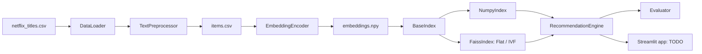

# Semantic Recommendation Engine

Semantic Recommendation Engine is an in-progress local semantic search project over Netflix Movies and TV Shows. It is designed to represent titles and descriptions with SentenceTransformers embeddings and retrieve titles by meaning using vector similarity, without sending queries to an external inference API.

## Features

- Semantic search over Netflix titles by meaning.
- Normalized text embeddings with inner product used as cosine similarity.
- Exact NumPy baseline and exact FAISS Flat / approximate FAISS IVF vector search.
- Evaluation with Recall@K, MRR, and query latency; measured results: TODO.
- Streamlit search demo: TODO.

## Architecture

- `src/data_loader.py` — `DataLoader`: reads CSV data, applies column mappings, and validates required columns.
- `src/preprocessor.py` — `TextPreprocessor`: cleans catalog text, builds embedding text, removes short rows and duplicates, and prepares item IDs.
- `src/encoder.py` — `EmbeddingEncoder`: creates normalized SentenceTransformers embeddings and saves or loads NumPy arrays.
- `src/index.py` — `BaseIndex`, `NumpyIndex`, `FaissIndex`: common vector-search interface, exact NumPy and FAISS Flat search, and approximate FAISS IVF search.
- `src/engine.py` — `RecommendationEngine`: combines the encoder, index, and item metadata.
- `src/factory.py` — `build_engine`: constructs the recommendation pipeline (TODO: implementation).
- `src/evaluator.py` — `Evaluator`: computes ranking metrics and average query latency.
- `src/app.py` — Streamlit interface for interactive recommendations (TODO: implementation).



## Installation

Use Python 3.10 or later.

```bash
python3 -m venv .venv
source .venv/bin/activate
pip install -r requirements.txt
```

## Data

Dataset: Netflix Movies and TV Shows from Kaggle. Dataset page URL and license: TODO. Download `netflix_titles.csv` from the verified Kaggle dataset page and place it at `data/raw/netflix_titles.csv`. Do not commit raw data.

See `docs/DATA_CARD.md` for dataset provenance, license, and known limitations (TODO: create this document).

## Usage

Run the data and embedding steps in order. The repository includes a 60-row evaluation template with 50 drafted queries; review the queries and relevance labels against `docs/eval_draft_notes.md` before treating the set as a final benchmark. The template generator does not overwrite an existing file unless `--force` is passed. Search CLI and Streamlit app are planned but not implemented yet (TODO).

```bash
python -m scripts.process_data
python -m scripts.build_embeddings
# Review data/processed/eval_template.csv and docs/eval_draft_notes.md manually.
python -m scripts.build_eval_queries
```

To create a new blank template intentionally, run `python -m scripts.make_eval_template --force`, then annotate it before rebuilding `eval_queries.csv`.

## Evaluation

TODO: add measured results from `results/`. Do not replace TODO values with targets or estimates.

| Model / index | Recall@1 | Recall@3 | Recall@10 | MRR | Average latency (ms) |
| --- | --- | --- | --- | --- | --- |
| TODO | TODO | TODO | TODO | TODO | TODO |

## Project Structure

```text
semantic-recsys/
├── configs/
│   └── dataset.json
├── data/
│   ├── raw/
│   │   └── netflix_titles.csv  # download from Kaggle; raw data is not committed
│   └── processed/
│       ├── items.csv           # generated by process_data
│       ├── eval_template.csv   # generated by make_eval_template, then annotated
│       ├── eval_queries.csv    # validated by build_eval_queries
│       └── embeddings_<slug>.npy  # generated locally; binary files are ignored
├── docs/
│   ├── DATA_CARD.md            # TODO
│   └── figures/
├── notebooks/
│   └── 01_eda.py
├── results/                    # TODO: measured evaluation results
├── scripts/
│   ├── process_data.py
│   ├── make_eval_template.py
│   ├── build_eval_queries.py
│   ├── build_embeddings.py
│   └── search_cli.py            # TODO: planned after Gate C
├── src/
│   ├── data_loader.py
│   ├── preprocessor.py
│   ├── encoder.py
│   ├── index.py
│   ├── engine.py
│   ├── factory.py               # TODO
│   ├── evaluator.py
│   └── app.py                   # TODO
├── tests/
├── CONTRACTS.md
├── LICENSE                      # TODO: add the MIT license text
├── README.md
└── requirements.txt
```

## Team and Roles

| Role | Name | Responsibilities |
| --- | --- | --- |
| R1 — Team Lead / Software Architect | TODO | Architecture, integration, code review, and release. |
| R2 — Data Engineer | TODO | Data loading, preprocessing, EDA, and evaluation queries. |
| R3 — ML Engineer | TODO | Embeddings, vector indexes, and benchmarks. |
| R4 — Evaluation, Interface & Documentation Lead | TODO | Evaluation, demo interface, documentation, and report. |

## Acknowledgements

- SentenceTransformers: TODO: add the verified project URL and license details.
- FAISS: TODO: add the verified project URL and license details.
- Netflix Movies and TV Shows dataset: TODO: add the verified Kaggle URL and dataset license.

Netflix is not affiliated with, associated with, or sponsoring this project.

## License

This project is intended to be released under the MIT License. TODO: add the `LICENSE` file with the MIT license text.
