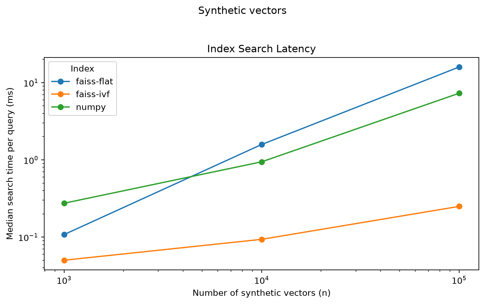
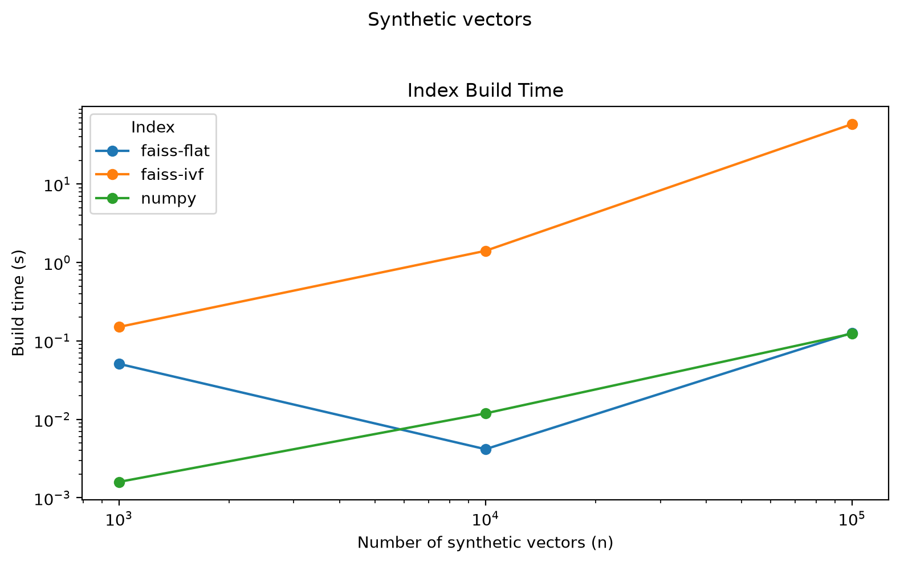
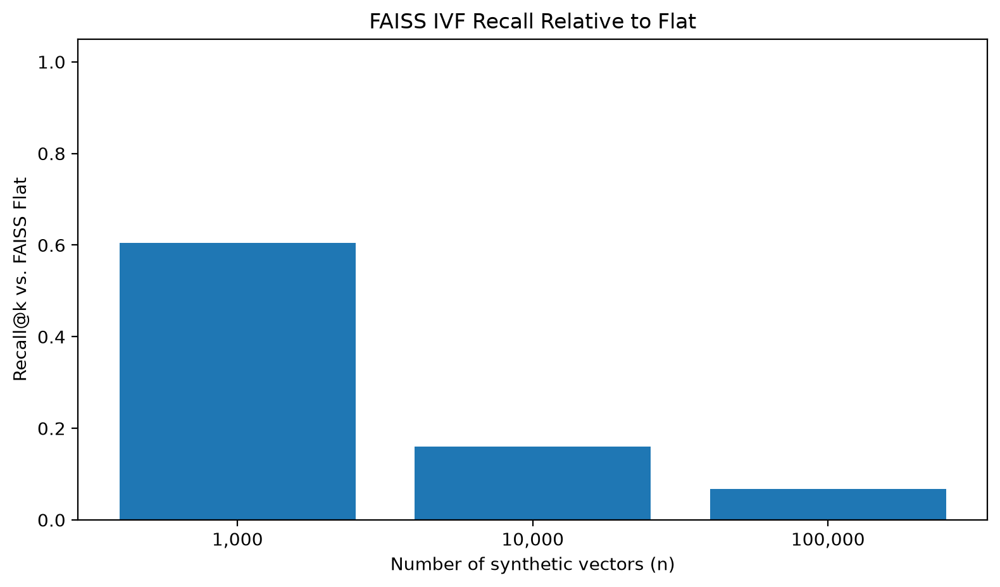
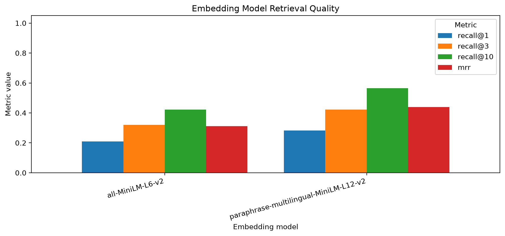
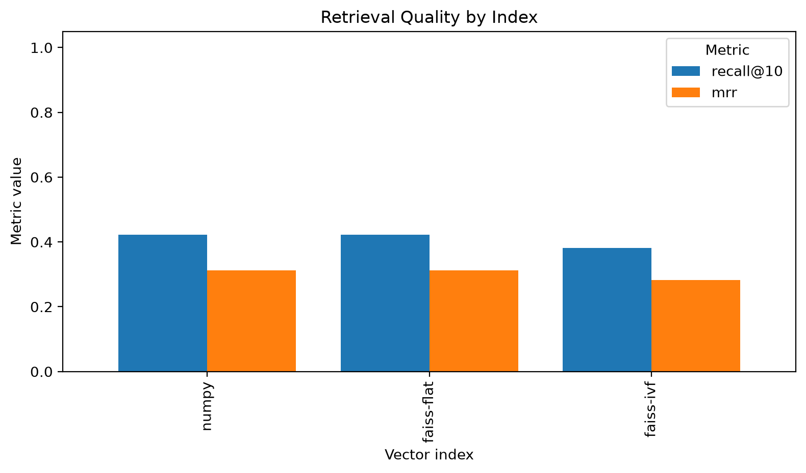

# Semantic Recommendation Engine: Technical Report

## Abstract

This project implements local semantic retrieval for Netflix titles using normalized SentenceTransformers embeddings and NumPy/FAISS indexes. On 50 reviewed queries, NumPy and FAISS Flat both achieved Recall@10 0.4217; FAISS IVF reached 0.3817. In the real-data CPU run, Flat measured 74.452 ms/query and IVF 76.6147 ms/query. On 100,000 synthetic vectors, IVF searched in 0.2496 ms/query with Recall@10 0.067 relative to Flat. A second embedding model scored higher on this query set, but the result is limited to one evaluation corpus and one run per model.

## 1 Introduction

Keyword-based search systems match literal text and can miss relevant items when they use different vocabulary or when a concept is implied rather than stated directly. This project addresses that limitation by building a local semantic search and recommendation pipeline that embeds textual metadata as vectors and retrieves similar items by vector similarity.

The system is intentionally local: it does not send queries to an external API, and it uses the project codebase to transform raw catalog data into the processed item table, embeddings, and vector indexes. The project goal is to evaluate whether normalized SentenceTransformers embeddings combined with exact or approximate vector search can recover semantically relevant items from a catalog of Netflix titles.

### Contributions

- The repository implements an end-to-end data pipeline: `DataLoader`, `TextPreprocessor`, `EmbeddingEncoder`, index builders, and the recommendation engine.
- The system compares exact NumPy search to FAISS Flat and FAISS IVF retrieval using the same embedding model and the same evaluation queries.
- The evaluation framework computes Recall@k, HitRate@k, MRR, and average latency for each query and for the aggregate run.
- The repository includes a draft error analysis, synthetic index benchmark, and a two-model comparison based on saved evaluation artifacts.

## 2 Related Work

Sentence-BERT adapts BERT-style encoders to produce fixed-length sentence embeddings that can be compared efficiently and used for semantic retrieval (Reimers & Gurevych, 2019). This motivates the use of a shared text representation for titles, genres, and descriptions when searching a catalog by meaning rather than by exact word overlap.

FAISS provides efficient similarity-search primitives for dense vectors, including exact and approximate indexing strategies. The exact Flat index is a strong reference baseline, while IVF organizes full vectors into inverted lists and searches selected lists to reduce the number of vectors examined (Johnson, Douze, & Jégou, 2017). The project's `IndexIVFFlat` configuration does not compress the stored vectors. The current project compares a baseline NumPy search against a FAISS Flat exact search and a FAISS IVF approximate search.

## 3 Method

### 3.1 Data

The dataset is the [Netflix Movies and TV Shows catalog on Kaggle](https://www.kaggle.com/datasets/shivamb/netflix-shows), whose page lists CC0: Public Domain. The raw file is stored locally at `data/raw/netflix_titles.csv` and is not redistributed here. The project contract defines canonical fields as `item_id`, `title`, `description`, `category`, optional `year`, and embedding `text`. Mapping and measured catalog statistics are documented in [DATA_CARD.md](DATA_CARD.md).

The preprocessing contract is implemented in the project pipeline and follows a compact, reproducible pattern:

- `listed_in` is mapped to `category` and reduced to the first genre value.
- `release_year` is mapped to `year`.
- `type` is included in the combined text representation.
- `rating` is deliberately ignored.
- Missing or low-quality rows are filtered according to the preprocessor rules.
- Duplicate rows are removed.
- The embedding text is constructed as `title + ". " + type + ". " + category + ". " + description`.

This design keeps the retrieval signal focused on title, category, type, and description while remaining compatible with the project's evaluation pipeline and the raw dataset format.

### 3.2 Embeddings

The primary retrieval model is `sentence-transformers/all-MiniLM-L6-v2`. The encoder loads lazily, encodes item strings in batches, and stores normalized float32 embeddings. Each vector is L2-normalized before indexing, so inner product is equivalent to cosine similarity for ranking. A second model, `sentence-transformers/paraphrase-multilingual-MiniLM-L12-v2`, was measured on the same query set. Derivations and a numerical example are in [MATH.md](MATH.md).

The project stores embeddings as `np.ndarray` with shape `(n_items, d)`, where the measured model dimension is 384. This matches the project contract and the embedding cache used by the engine and retrieval evaluation scripts.

### 3.3 Indexes

The project uses a common `BaseIndex` interface, allowing the recommendation engine to operate equally with any concrete search implementation. The implemented variants are:

- `NumpyIndex`: exact baseline vector search implemented with NumPy matrix operations.
- `FaissIndex(index_type="flat")`: exact FAISS dot-product search over normalized vectors.
- `FaissIndex(index_type="ivf")`: approximate FAISS inverted-file index that probes a subset of lists and may trade recall for speed.

All indexes operate on the same normalized embedding matrix and return top-k items ordered by descending similarity score.

### 3.4 System Architecture and OOP Design

The repository follows a modular object-oriented design:

- `DataLoader` reads and validates the dataset.
- `TextPreprocessor` cleans text, constructs the embedding field, and writes processed catalog rows.
- `EmbeddingEncoder` loads the chosen SentenceTransformers model and produces normalized embeddings.
- `BaseIndex` defines the common search contract for exact and approximate implementations.
- `NumpyIndex` and `FaissIndex` implement the index logic and share the same search API.
- `RecommendationEngine` binds the index, encoder, and catalog metadata into a single retrieval object.
- `Evaluator` computes retrieval quality metrics and latency for the evaluation queries.

This architecture keeps each concern isolated and lets the engine switch index implementations without changing the search flow or the evaluator interface.

### 3.5 Evaluation Protocol

The evaluation protocol follows the contract for information retrieval in the project:

- Recall@k: for each query, `|relevant ∩ top-k| / |relevant|`, averaged over the evaluation set.
- HitRate@k: whether at least one relevant item is retrieved within the top-k cutoff.
- MRR: reciprocal rank of the first relevant item in the top-10, or zero when none is found.
- Latency: time for one `engine.recommend()` call, measured with `perf_counter` and reported in milliseconds.

The repository uses 50 manually reviewed queries and 8,804 processed catalog items. The evaluation set is stored in `data/processed/eval_queries.csv`; each index run is saved in `results/metrics_<index>.json` and `results/per_query_<index>.csv`.

## 4 Experiments

### 4.1 Setup

The measured retrieval results are based on the project's standard configuration:

- Dataset: Netflix Movies and TV Shows catalog, processed to 8,804 items.
- Model: `sentence-transformers/all-MiniLM-L6-v2`.
- Query set: 50 manually reviewed queries.
- Embeddings: normalized float32 vectors with embedding dimension 384.
- Search kernels: NumPy exact search, FAISS Flat exact search, FAISS IVF approximate search.
- Warm-up: one untimed warm-up query per index before latency measurement. The project records that latency is CPU-dependent and varies by machine and load.
- Software versions: Python 3.14.4, NumPy 2.5.4, pandas 3.1.0, SentenceTransformers 6.2.0, and FAISS 1.15.1 (`results/metrics_<index>.json`).

The reproducible evaluation scripts are `python -m scripts.run_evaluation --index numpy`, `--index faiss-flat`, and `--index faiss-ivf`.

### 4.2 Index Benchmark

The R3-9 benchmark uses deterministic normalized float32 synthetic vectors (seed 42), with dimensions 384, 100 queries, k=10, one warm-up, and three timed batches. It records build time, median per-query search time, vector memory, and IVF Recall@10 relative to exact FAISS Flat. These are synthetic index microbenchmarks, not measurements on catalog embeddings.

| n | Index | Build (s) | Search (ms/query) | Vector memory (MB) | Recall@10 vs Flat |
| ---: | --- | ---: | ---: | ---: | ---: |
| 1,000 | NumPy | 0.0016 | 0.2743 | 1.536 | 1.000 |
| 1,000 | FAISS Flat | 0.0510 | 0.1078 | 1.536 | 1.000 |
| 1,000 | FAISS IVF | 0.1507 | 0.0502 | 1.536 | 0.605 |
| 10,000 | NumPy | 0.0119 | 0.9424 | 15.360 | 1.000 |
| 10,000 | FAISS Flat | 0.0042 | 1.5800 | 15.360 | 1.000 |
| 10,000 | FAISS IVF | 1.4083 | 0.0935 | 15.360 | 0.160 |
| 100,000 | NumPy | 0.1239 | 7.2881 | 153.600 | 1.000 |
| 100,000 | FAISS Flat | 0.1267 | 15.9278 | 153.600 | 1.000 |
| 100,000 | FAISS IVF | 58.1459 | 0.2496 | 153.600 | 0.067 |

The 100,000-vector run shows that IVF search was much faster but had low recall and a substantially longer build. NumPy was faster than Flat for this one synthetic run; results should not be generalized beyond this hardware and protocol.

### 4.3 Model Comparison

Two models were evaluated on the same 50 English queries with FAISS Flat:

| Model | Dimension | Encode time (s) | Recall@1 | Recall@3 | Recall@10 | MRR | Latency (ms) |
| --- | ---: | ---: | ---: | ---: | ---: | ---: | ---: |
| all-MiniLM-L6-v2 | 384 | NaN (cached) | 0.2100 | 0.3200 | 0.4217 | 0.3116 | 117.3171 |
| paraphrase-multilingual-MiniLM-L12-v2 | 384 | 1185.1598 | 0.2817 | 0.4217 | 0.5650 | 0.4394 | 85.5581 |

The first model's encoding time is NaN because its item vectors were already cached; the second was encoded during the run. The multilingual model scored higher on this English evaluation set, but the result is not sufficient to generalize to other datasets or languages.

### 4.4 Retrieval Quality

The measured comparison uses 8,804 processed items and the SentenceTransformers model above. Latency is reported in milliseconds and is machine-dependent due to CPU load and environment conditions.

| Model / index | Queries | Recall@1 / @3 / @10 | HitRate@1 / @3 / @10 | MRR | Average latency (ms) | Artifacts |
| --- | ---: | --- | --- | ---: | ---: | --- |
| all-MiniLM-L6-v2 / NumPy | 50 | 0.2100 / 0.3200 / 0.4217 | 0.2400 / 0.3600 / 0.4800 | 0.3116 | 234.1056 | [metrics](../results/metrics_numpy.json), [per-query](../results/per_query_numpy.csv) |
| all-MiniLM-L6-v2 / FAISS Flat | 50 | 0.2100 / 0.3200 / 0.4217 | 0.2400 / 0.3600 / 0.4800 | 0.3116 | 74.4520 | [metrics](../results/metrics_faiss-flat.json), [per-query](../results/per_query_faiss-flat.csv) |
| all-MiniLM-L6-v2 / FAISS IVF | 50 | 0.1900 / 0.2700 / 0.3817 | 0.2200 / 0.3000 / 0.4400 | 0.2821 | 76.6147 | [metrics](../results/metrics_faiss-ivf.json), [per-query](../results/per_query_faiss-ivf.csv) |

### 4.5 Error Analysis

The saved [error-analysis review](ERROR_ANALYSIS.md) examines the ten lowest-Recall@10 queries, including source descriptions and top-three results. The draft review classifies eight cases primarily as model limitations and two as possible label incompleteness. These are reviewer judgments from a small sample, not automatically inferred causes or an independent team consensus. No primary ambiguous-query or data issue was assigned in the current draft. A separate raw/processed CSV check found none of the suspected strings `tripinto`, `murderhe`, or `newlife`; consequently, no preprocessing change was made from those examples.

A recurring observed pattern is lexical overlap between query terms and unrelated result titles, while a relevant item's description contains the full story concept. Some failures may also reflect missing or overly broad relevance labels. Both explanations require continued label review and controlled text-composition experiments before causal conclusions can be made.

## 5 Results

The repository supports a complete end-to-end evaluation flow and generates summary artifacts for each index. The measured retrieval quality is as follows:

| Model / index | Queries | Recall@1 / @3 / @10 | HitRate@1 / @3 / @10 | MRR | Average latency (ms) |
| --- | ---: | --- | --- | ---: | ---: |
| all-MiniLM-L6-v2 / NumPy | 50 | 0.2100 / 0.3200 / 0.4217 | 0.2400 / 0.3600 / 0.4800 | 0.3116 | 234.1056 |
| all-MiniLM-L6-v2 / FAISS Flat | 50 | 0.2100 / 0.3200 / 0.4217 | 0.2400 / 0.3600 / 0.4800 | 0.3116 | 74.4520 |
| all-MiniLM-L6-v2 / FAISS IVF | 50 | 0.1900 / 0.2700 / 0.3817 | 0.2200 / 0.3000 / 0.4400 | 0.2821 | 76.6147 |

The exact NumPy and FAISS Flat runs match in retrieval quality, consistent with both searching the same normalized vectors exactly. IVF has lower recall and MRR on this real query set and was slightly slower than Flat in this run. The separate synthetic benchmark shows a different workload-dependent trade-off: IVF was much faster at n=100,000, with Recall@10 0.067 relative to Flat and a build time of 58.1459 s.

## Figures

*Median search time per query by index and synthetic vector-set size.*

*Measured index build time on deterministic synthetic vectors.*

*IVF Recall@10 relative to exact FAISS Flat for the three synthetic sizes.*

*Recall@1, Recall@3, Recall@10, and MRR for the two measured embedding models.*

*Recall@10 and MRR for the three indexes on the 50-query catalog evaluation.*

## 6 Limitations

This project has several important limitations that should be stated explicitly:

1. Dataset coverage and licensing: the raw dataset is a third-party Kaggle asset and is not redistributed in the repository. The project stores only the processed files needed for local reproduction, which requires a local download of the raw archive.
2. Label quality: the evaluation set contains 50 manually reviewed queries, which is useful but small. The error analysis notes that some labels are incomplete or slightly mismatched, which weakens any claim of a definitive upper bound on retrieval quality.
3. Model and language limitations: two models were compared, including a multilingual model, but both were evaluated on the same English query set. Multilingual query quality and broader model performance remain unmeasured.
4. Approximate-search trade-off: IVF had lower recall and was slightly slower than Flat on the real-data run. On synthetic n=100,000 vectors it searched faster, but recovered only 0.067 of Flat's top-ten results and took 58.1459 seconds to build.
5. Hardware dependence: reported latency values are CPU- and load-dependent, and machine-level variation is expected.
6. Evaluation scope: the model comparison contains two models and the synthetic index benchmark contains three vector sizes from one machine and one run configuration; these measurements are not a broad hardware or dataset scaling study.

## 7 Conclusion and Future Work

This project demonstrates a working local semantic recommendation pipeline over a real dataset using SentenceTransformers embeddings and vector-search indexes. The implementation is consistent with the repository contract, the evaluation pipeline produces reproducible metrics, and the exact search baseline matches the FAISS Flat implementation in retrieval quality.

The results verify agreement between NumPy and FAISS Flat on retrieval quality. IVF's speed advantage depends on collection size and workload and comes with a measured recall reduction. On this 50-query set, the multilingual MiniLM model outperformed all-MiniLM-L6-v2 on the recorded metrics, but more query sets are needed before selecting a default model. The reviewed worst queries suggest title-word overlap and possible label gaps as investigation targets, not proven single root causes.

The most realistic next steps are:

1. Review the candidate relevance-label changes in the error-analysis file before modifying the evaluation set.
2. Compare title-plus-description and description-only text while holding data, index, and query labels fixed.
3. Tune IVF `nprobe` and report recall, search latency, and build latency together.
4. Repeat model comparison on additional query sets, including multilingual queries, before generalizing the current model result.

## References

- Reimers, N., & Gurevych, I. (2019). *Sentence-BERT: Sentence Embeddings using Siamese BERT-Networks*.
- Johnson, J., Douze, M., & Jégou, H. (2017). *Billion-scale similarity search with GPUs*.
- Kaggle Netflix Movies and TV Shows dataset used as the source catalog for this project. The raw archive is stored locally at `data/raw/netflix_titles.csv` and is not redistributed in this repository.

